# ORVIAN · Serviços Digitais

Site de orçamentos da ORVIAN, com assistente virtual e automação de leads com IA.

**🔗 Link público:** https://spectacular-wisp-00cb9c.netlify.app


---

## 1. Problema

A ORVIAN é a agência digital da qual sou fundador e único operador. Eu explicava serviços e preços manualmente pelo WhatsApp e pelo Instagram. Os orçamentos demoravam e os contatos não ficavam registrados em lugar nenhum.

**Público:** pequenas e médias empresas e profissionais autônomos que precisam de identidade visual, gestão de redes sociais, sites e conteúdo.

**Solução:** o próprio cliente monta o orçamento no site e vê a estimativa de preço na hora. Ele tira dúvidas com a assistente **Orvia** e o pedido chega organizado e classificado por IA, sem trabalho manual.

---

## 2. Funcionalidades

| Funcionalidade | O que faz |
|---|---|
| **Catálogo de serviços** | 11 serviços com imagem, pacotes, faixa de preço, prazo e público indicado |
| **Simulador de orçamento** | 4 etapas (O que precisa → Sua empresa → Contato → Proposta), com estimativa atualizada em tempo real e opção de prazo expresso |
| **Protocolo e WhatsApp** | Ao enviar, o cliente recebe um protocolo `ORV-XXXXXX` e um atalho para continuar pelo WhatsApp |
| **Assistente Orvia (chat)** | Responde sobre preços, prazos, pagamento e serviços, lista os produtos, adiciona serviços ao orçamento e muda de aparência conforme o atendimento |
| **Encerramento do atendimento** | Botão "Minha dúvida foi resolvida" e convite para seguir @byorvian no Instagram |
| **Automação de leads (n8n)** | Cada orçamento é classificado por IA, salvo em planilha e gera e-mails automáticos |
| **Seções institucionais** | Topo com vídeo em capítulos, Soluções, Como funciona, Manifesto e Dúvidas frequentes |

---

## 3. Tecnologias e ferramentas

| Ferramenta | Tipo | Uso no projeto |
|---|---|---|
| **n8n** | Low-code | Fluxo visual de automação: webhook → IA → Google Sheets → Gmail |
| **Netlify** | Hospedagem / serverless | Publicação do site e funções `/api/quote` e `/api/chat` |
| **Google Gemini** | IA | Classificação dos leads dentro do fluxo n8n |
| **Google Sheets / Gmail** | Integrações | Registro dos leads e e-mails automáticos |
| **ngrok** | Túnel | Endereço público para o n8n, que roda localmente |
| **React + TypeScript** | JavaScript | Interface, estado do orçamento e lógica do chat |
| **Tailwind CSS** | CSS | Estilos, tokens de design e responsividade |
| **Vite** | Build | Empacotamento do site |

---

## 4. Personalizações com HTML, CSS e JavaScript

| Onde | Como foi aplicado | Resultado |
|---|---|---|
| **HTML** | Formulário em etapas com campos rotulados, campo-isca invisível (honeypot) e aceite de contato; janelas de pacotes e de chat com papéis de diálogo (ARIA) | Pedido completo e validado; robôs barrados sem incomodar o cliente |
| **CSS** | Gradiente escuro sobre os vídeos do topo; cards com a imagem de cada serviço; grade de 1 a 3 colunas; cores, raios e sombras centralizados em variáveis | Texto legível sobre o vídeo, identidade consistente e layout adaptável |
| **JavaScript** | Soma das faixas de preço em tempo real (expresso +25% só em projetos); troca automática dos capítulos do vídeo; chat que identifica a intenção da pergunta | Estimativa instantânea e dúvidas resolvidas sem sair da página |
| **JavaScript (servidor)** | Função no Netlify que valida os dados, recalcula os valores pelo catálogo, gera o protocolo e envia ao n8n com chave secreta | Valores que não podem ser manipulados pelo navegador |
| **JavaScript (n8n)** | Nós de código que pontuam o lead por regras e montam a planilha e os e-mails em HTML | Pedido organizado, priorizado e com resposta automática |

**Responsividade e acessibilidade:**
- Testado em 360, 390, 768, 1024 e 1440 px, sem rolagem horizontal.
- Navegação completa por teclado, foco visível, Esc fecha janelas e foco preso nos modais.
- Respeita a opção "reduzir movimento" e tem botão para pausar o vídeo.
- Imagens em WebP com carregamento sob demanda.

---

## 5. Recurso inteligente

### Automação de leads com IA (n8n + Gemini)

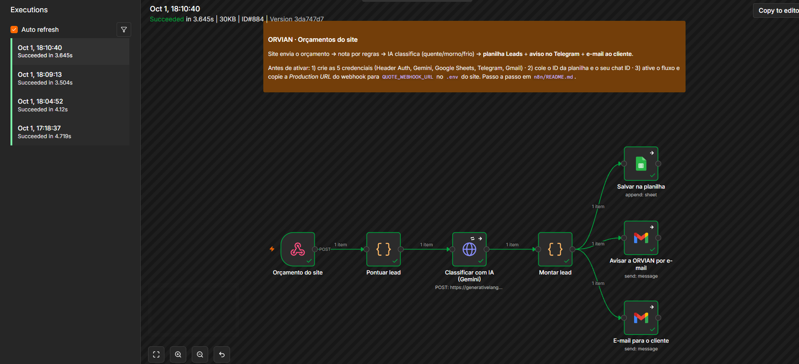

*Execução real disparada por um orçamento do site: todos os nós concluídos (verde), com histórico de execuções bem-sucedidas à esquerda.*

1. **Orçamento do site:** webhook protegido por chave secreta (`X-Orvian-Secret`).
2. **Pontuar lead:** nota inicial por regras (valor, recorrência, quantidade de serviços, urgência e detalhes do pedido).
3. **Classificar com IA (Gemini):** devolve nota de 1 a 10, prioridade (quente, morno ou frio), resumo e próximo passo sugerido. Se a IA falhar, vale a nota por regras.
4. **Montar lead:** prepara a linha da planilha e os e-mails.
5. **Saídas em paralelo:** linha na planilha **Leads**, e-mail de confirmação para o cliente e e-mail de aviso para a ORVIAN.

### Resultado da automação

| E-mail de aviso para a ORVIAN | E-mail de confirmação para o cliente |
|---|---|
| 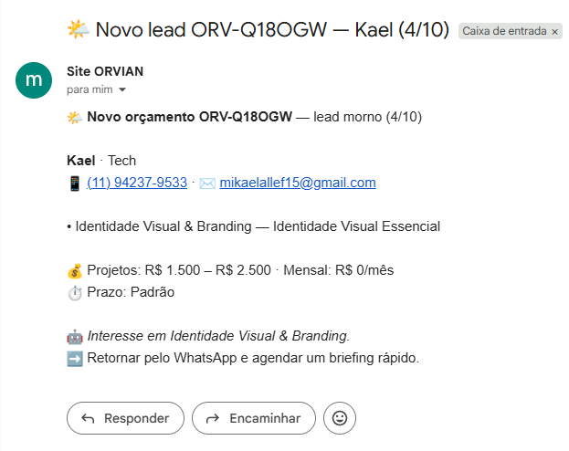 | 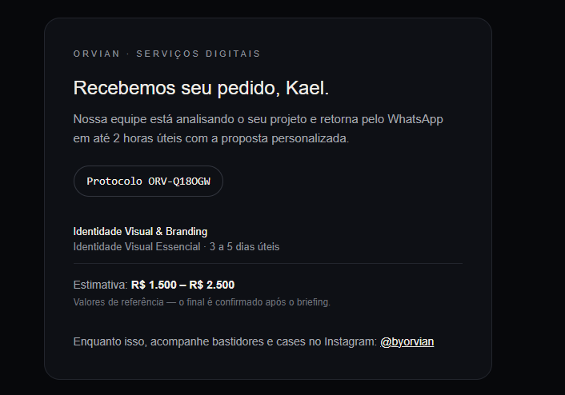 |

*O aviso traz o lead já classificado pela IA (prioridade, nota, resumo e próximo passo) e o WhatsApp do cliente com link direto. O cliente recebe o protocolo e o resumo do pedido.*

### Assistente Orvia

O chat reconhece a intenção da mensagem (preço, prazo, pagamento, um serviço específico, lista de produtos, despedida). Ele responde com dados do catálogo e oferece atalhos de ação. A mascote muda de aparência a cada momento do atendimento: **olá → escrevendo → ajudando → sucesso**.

O código também já está pronto para usar o Gemini no chat: basta configurar a variável `GEMINI_API_KEY`.

---

## 6. Prints da aplicação

| | |
|---|---|
| **Serviços** 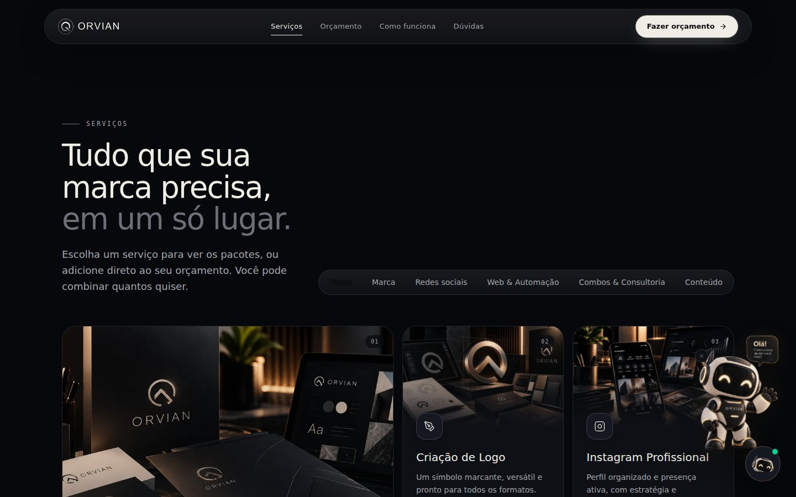 | **Pacotes de um serviço** 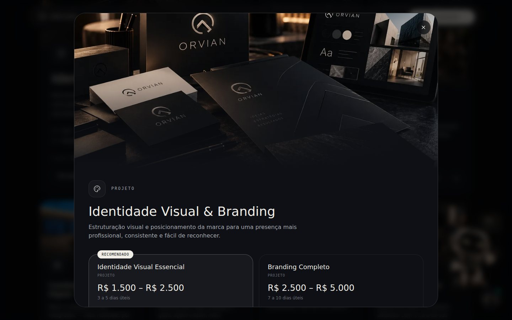 |
| **Simulador de orçamento** 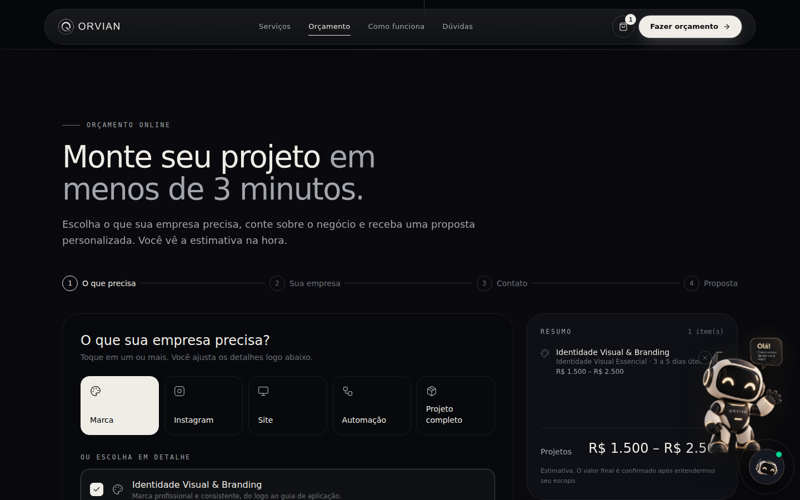 | **Orçamento registrado** 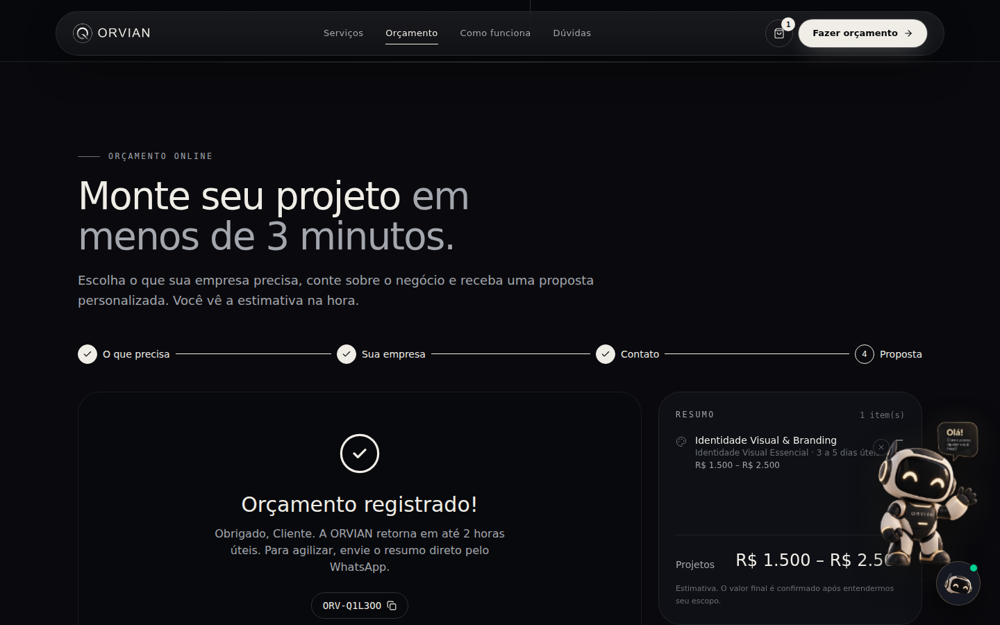 |
| **Chat: Orvia ajudando** 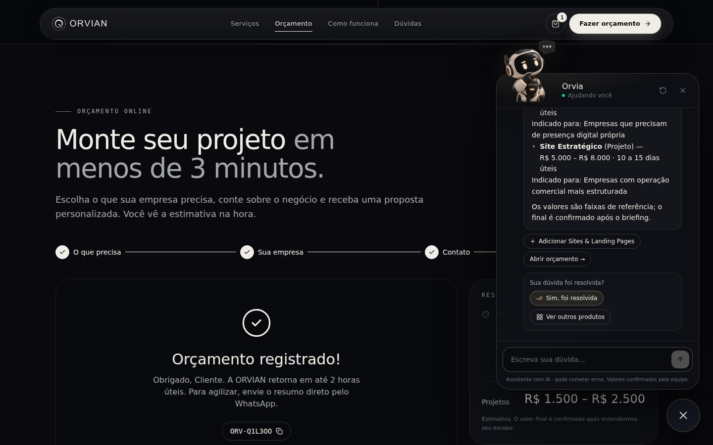 | **Chat: atendimento concluído** 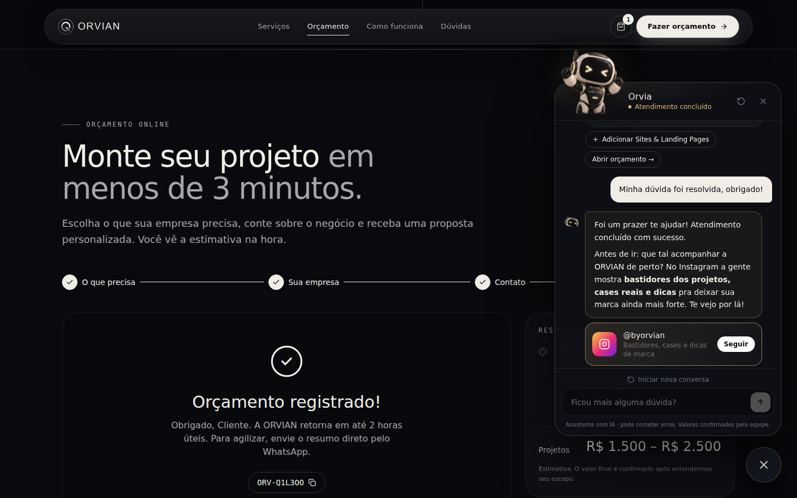 |
| **Celular: início**  | **Celular: serviços** 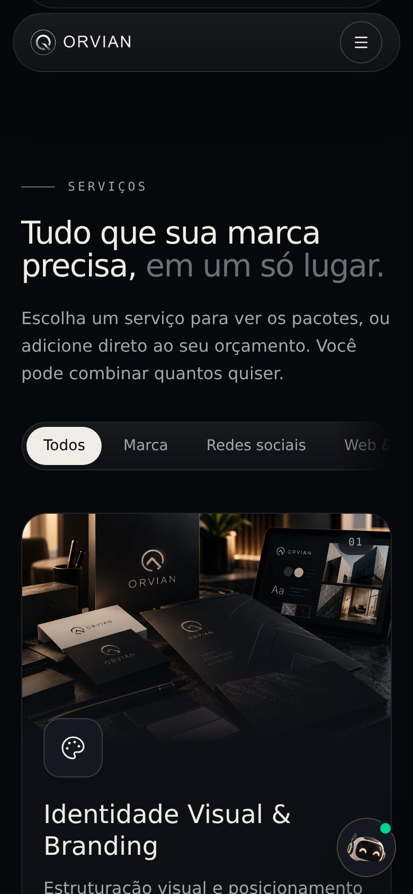 |

**Publicação no Netlify (site + funções):**

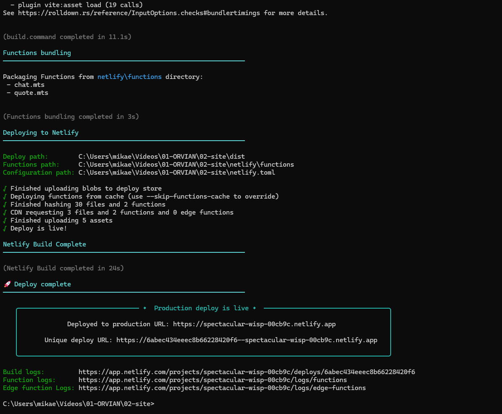

---

## 7. Como acessar e testar

**Acesse:** https://spectacular-wisp-00cb9c.netlify.app (funciona no computador e no celular).

| Teste | Passos |
|---|---|
| **Montar um orçamento** | Clique em **Fazer orçamento**, escolha um ou mais serviços, avance as etapas, preencha nome, e-mail e WhatsApp, marque a autorização e clique em **Enviar orçamento**. Você recebe um protocolo `ORV-XXXXXX`. |
| **Ver pacotes** | Na seção **Serviços**, clique em **Ver pacotes** em qualquer card. |
| **Conversar com a Orvia** | Clique no ícone da mascote no canto inferior direito e pergunte, por exemplo, "quanto custa um site?" ou "quais serviços vocês têm?". Depois clique em **Sim, foi resolvida**. |
| **Automação** | Ao enviar um orçamento com o seu e-mail, você recebe a confirmação da ORVIAN. O lead aparece classificado na planilha. |

> **Observação:** o n8n roda no computador do autor, exposto pelo ngrok. A automação (planilha e e-mails) funciona enquanto essa máquina estiver ligada. O restante do site funciona sempre, e o orçamento gera o protocolo mesmo com a automação desligada.

### Rodar localmente

```bash
npm install
cp .env.example .env    # opcional: GEMINI_API_KEY, QUOTE_WEBHOOK_URL, QUOTE_WEBHOOK_SECRET
npm run dev             # http://localhost:3000
```

Documentação técnica completa em [`docs/DESENVOLVIMENTO.md`](docs/DESENVOLVIMENTO.md) e configuração do fluxo em [`n8n/README.md`](n8n/README.md).

---

Feito por **Mikael** · [ORVIAN](https://www.instagram.com/byorvian/)
